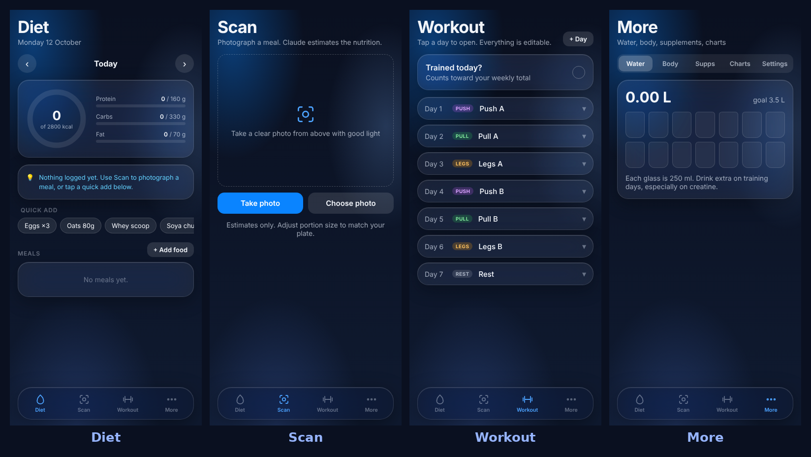

<div align="center">

# 🍽️ Bulk

### diet + workout tracker · installable · AI knows what's on your plate

[](https://bulking-tracker-pro.vercel.app)
[](#-install-it-like-a-real-app)
[](#-license)

[](https://github.com/kundurukalyan945-max/bulking-tracker-pro/stargazers)



</div>

<br>

one codebase → **iPhone · Android · desktop**, with a frosted-glass UI that looks like it belongs next to iMessage and WhatsApp, and a camera tab that actually reads what you're eating.

<br>

## ✨ what it does

| | |
|---|---|
| 🧊 **glass UI** | translucent cards, blurred nav, iOS-style sheets, system blue — not another bootstrap dashboard |
| 📸 **AI scan** | photograph a meal → an LLM reads the plate and estimates kcal / protein / carbs / fat |
| 🏋️ **your split, your rules** | every workout day and exercise is add/edit/delete, nothing hardcoded |
| 💧 **the whole stack** | water, body weight, sleep, supplements, 7-day charts |
| 🔐 **accounts, optional** | email, Google, Facebook, or phone — synced via Firebase, or skip it and stay fully local |
| 📲 **installs like an app** | manifest + service worker, home-screen icon, works offline (minus scanning) |

<br>

## 🚀 get it running — 60 seconds

```
1. fork / clone this repo
2. vercel.com → Add New Project → import it
3. Settings → Environment Variables → add ONE key (below)
4. Deploy
```

That's it — `api/scan.js` ships as a Vercel serverless function automatically, so the AI scan endpoint is just *there*, no extra setup.

<br>

### 🔑 which key?

<table>
<tr><td width="50%" valign="top">

**🆓 `GEMINI_API_KEY`** — genuinely free

Grab one at [aistudio.google.com/apikey](https://aistudio.google.com/apikey). Sign in with Google, no card, no billing screen, ever. Runs on Gemini 2.5 Flash, which handles the vision task fine.

**→ recommended if you just want it working right now.**

</td><td width="50%" valign="top">

**💎 `ANTHROPIC_API_KEY`** — what it was built on

Grab one at [console.anthropic.com](https://console.anthropic.com/settings/keys). New accounts get $5 free credit in supported regions (~250–500 scans). If you see *"credit balance too low"*, your account didn't get the auto-credit — add a few dollars in Plans & Billing.

</td></tr>
</table>

Drop whichever one you have into Vercel → your project → **Settings → Environment Variables**. Name goes in the **Key** field exactly as shown above, the actual key goes in **Value**. Both set? Anthropic wins. Then **Deployments → ⋯ → Redeploy** so it picks it up.

<br>

## 📲 install it like a real app

| platform | how |
|---|---|
| **iPhone** | open the link in Safari → Share → **Add to Home Screen** |
| **Android** | open in Chrome → menu → **Install app** (or just tap the banner) |
| **desktop** | click the install icon in the address bar (Chrome/Edge) |

No App Store, no Play Store, no review queue — it's live the second you deploy.

<br>

## 🧠 how the scanning actually works

```
📷 photo  →  compressed to a small JPEG, in-browser, instantly
          →  POSTed to YOUR OWN /api/scan  (never calls the AI provider directly)
          →  api/scan.js attaches your key server-side
          →  model replies with STRICT JSON — forced schema, no freeform text
          →  you get an editable list + a portion-size slider
```

Your API key never ships inside the browser JS. If someone opens dev tools on your deployed site, there's nothing to find — the key only ever lives on Vercel's server, as an environment variable `api/scan.js` reads at request time.

<br>

## 🔐 accounts & sync (optional)

Ships unconfigured — the app works 100% local until you flip this on. To enable it:

<details>
<summary><b>tap to expand the Firebase setup</b></summary>

<br>

1. [console.firebase.google.com](https://console.firebase.google.com) → **Add project**
2. **Authentication → Sign-in method** → enable Email/Password, Google, Facebook, Phone (pick what you want — Email + Google need zero extra setup)
3. **Authentication → Settings → Authorized domains** → add your Vercel domain
4. **Firestore Database → Create database** → production mode
5. **Firestore → Rules**, paste and publish:
   ```
   rules_version = '2';
   service cloud.firestore {
     match /databases/{database}/documents {
       match /users/{uid} {
         allow read, write: if request.auth != null && request.auth.uid == uid;
       }
     }
   }
   ```
6. **Project settings → General → Your apps → Add app → Web** → copy the config object
7. Open `index.html`, find `const FIREBASE_CONFIG = {...}` near the top of the `<script>` block, paste your values in, redeploy

That config object is a public client identifier, not a secret — fine to ship in `index.html`, unlike the API key above.

</details>

<br>

## 🗂️ what's in here

```
index.html              the whole app — UI, logic, Firebase config, one file
api/scan.js             serverless function — secure AI scan proxy (Claude or Gemini)
manifest.webmanifest    PWA install metadata
sw.js                   service worker — offline caching, network-first
icon-*.png              app icons (any / maskable / apple-touch)
```

Vanilla JS, zero framework, zero build step. What you see is what ships.

<br>

## 📄 license

MIT — fork it, remix it, ship your own version.

<br>

<div align="center">

built by **[Kalyan Kunduru](https://linkedin.com/in/kalyan-kunduru-84487b287)** · AI/ML grad, building toward GenAI Engineering

[](https://linkedin.com/in/kalyan-kunduru-84487b287)
[](https://github.com/kundurukalyan945-max)

⭐ if this was useful, a star helps more than you'd think

</div>
